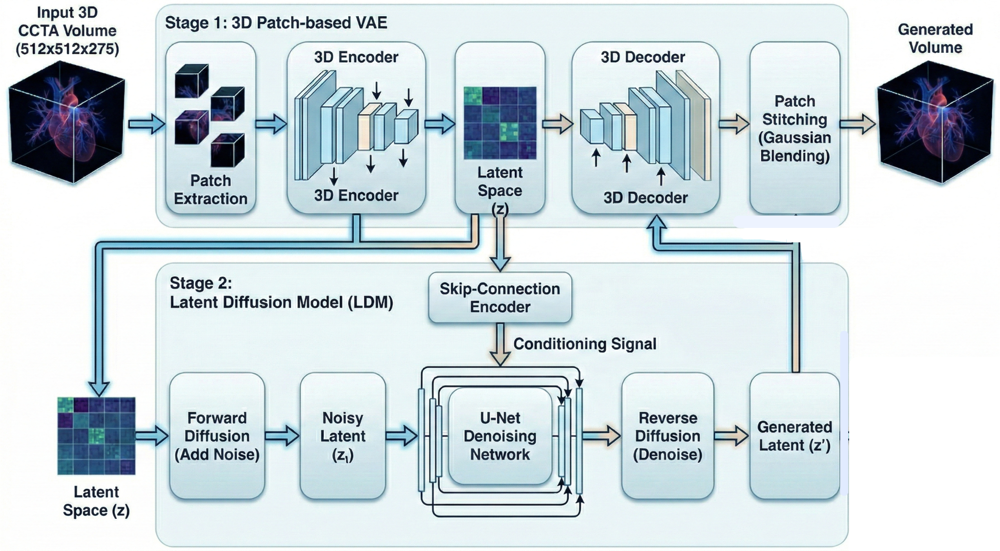
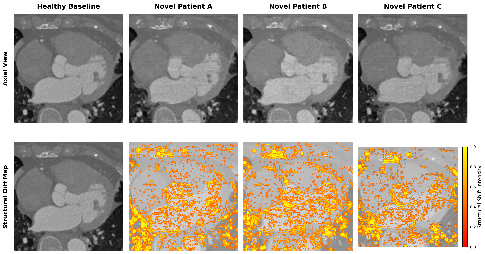
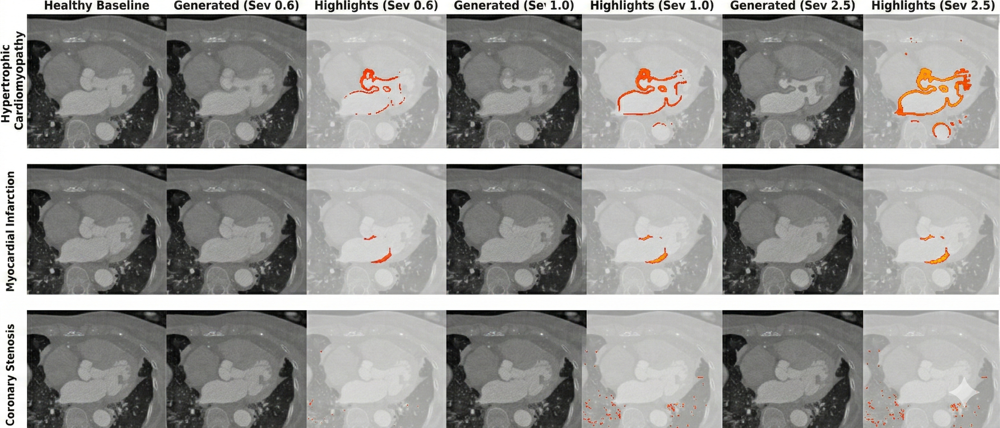
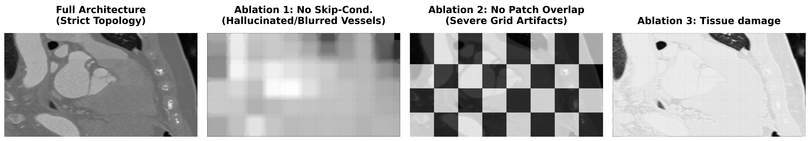

# CardioGen

A 3D generative modeling framework for synthesizing high-fidelity Coronary Computed Tomography Angiography (CCTA) volumes. This repository contains the implementation for training a two-stage Latent Diffusion Model (LDM) to generate synthetic cardiac images, alongside the pipeline for joint-augmented downstream segmentation.

 

## Repository Structure

### Model Training
* `vae.py` - Trains the 3D Variational Autoencoder to compress CCTA patches into latent representations.
* `diffusion.py` - Trains the Latent Diffusion Model (LDM) on the encoded latent space.

### Synthetic Generation & Analysis
* `generate_novelty.py` - Generates new synthetic images and reproduces **Figure 2** of the paper. *(Note: This replaces the legacy `image.py` and `reconstruct.py` scripts).*
* `generate_advanced_pathology.py` - Generates localized anatomical variations and reproduces **Figure 3** of the paper.
* `ablation.py` - Executes the architectural ablation studies and generates the **Figure 4** of the paper.

### Downstream Segmentation
* `generate_synthetic.py` - Mass-generates synthetic augmentations of the training dataset while safely preserving exact vessel geometry and ground-truth labels.
* `segmentation.py` - The optimized joint-training pipeline utilizing Native MONAI transforms, Focal Loss, and dynamic spatial padding.
* `test_segmentation.py` - Evaluates the trained segmentation network on the held-out validation set.

---

## How to Train and Evaluate the Model

### Step 1: Train the Generative Pipeline
The generative framework must be trained sequentially. The VAE must be fully converged before the diffusion model can learn the latent space.
1. Run `python vae.py` to train the autoencoder.
2. Run `python diffusion.py` to train the Latent Diffusion Model. 
*(Once completed, the LDM is fully trained and ready for generation).*

### Step 2: Reproduce Paper Figures
To generate the core visual results and synthetic samples discussed in the manuscript:

* Run `generate_novelty.py` to generate synthetic volumes as shown in **Figure 2**. 
   

* Run `python generate_advanced_pathology.py` to generate the pathological variations shown in **Figure 3**.
   

  
### Step 3: Joint-Augmented Segmentation
To test the efficacy of the synthetic data on downstream coronary artery segmentation:
1. **Generate Augmentations:** Run `python generate_synthetic.py` to create the synthetic twins for your specific training split.
2. **Train the Segmentation Model:** Run `python segmentation.py` to execute the joint-training loop (combining real and synthetic patients).
3. **Evaluate:** Run `python test_segmentation.py` to calculate the final Dice and HD95 metrics.

### Step 4: Ablation Studies
To reproduce the ablation study images:

 * Run `python ablation.py`  to reproduce the ablation study shown in **Figure 4**. 

---